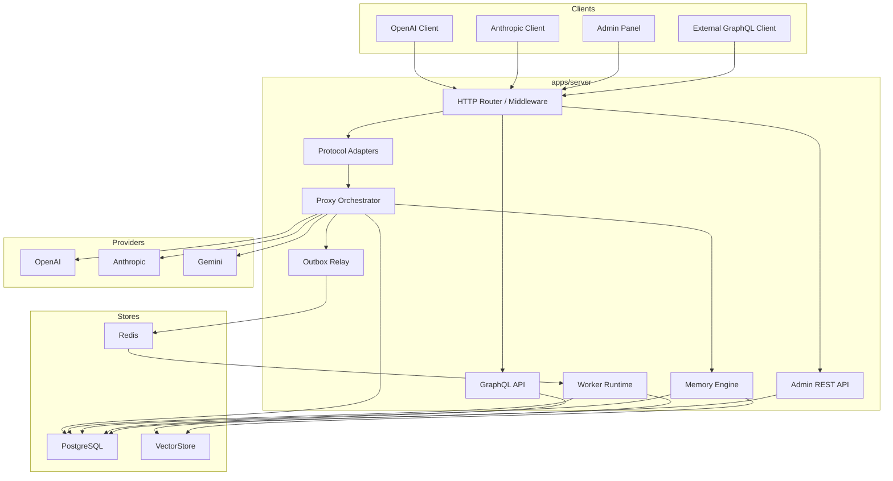
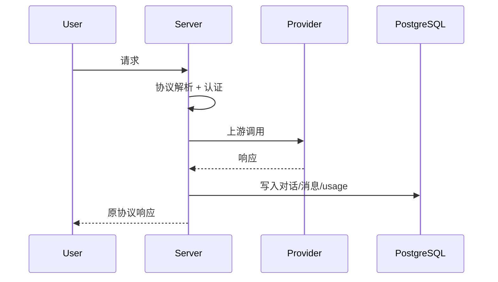
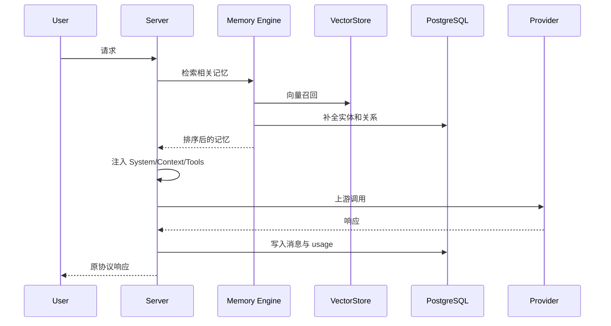
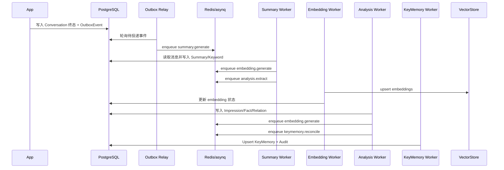

# MemStation — 架构设计文档

## 1. 总体架构

核心原则：

- `apps/server` 是唯一核心服务
- 协议适配、业务编排、存储访问必须分层
- 同步链路负责代理与查询，异步链路负责记忆生成
- 所有异步任务都通过 outbox + asynq 进入 Worker

---

## 2. 组件职责

## 2.1 HTTP Router / Middleware

职责：

- 路由分发
- API Key 认证
- 管理会话校验
- 请求上下文注入
- 速率限制
- tracing / logging / metrics

框架：

- `chi`

## 2.2 Protocol Adapters

职责：

- 解析 OpenAI Chat Completions
- 解析 OpenAI Responses API
- 解析 Anthropic Messages
- 将入站请求归一化为内部模型
- 将内部响应格式化回原协议

约束：

- adapter 只处理协议，不做业务判断

## 2.3 Proxy Orchestrator

职责：

- 判定 `transparent` / `inject` 模式
- 选择上游 provider
- 控制同步记忆检索与注入
- 记录请求、响应、usage、message
- 触发会话终态判定

## 2.4 Memory Engine

职责：

- query embedding
- 向量召回
- 有界图关系补全
- 时间衰减排序
- System Prompt / Context / Tool 组装

Memory Engine 不直接感知外部协议，只面向内部统一请求模型。

热路径约束：

- 先向量召回候选 `node_id`
- 再做 `1-2 hop` 邻域扩展
- 不做无界深度图遍历

## 2.5 GraphQL API

职责：

- 浏览用户、对话、记忆图谱
- 提供管理面板高密度查询
- 承载受控 mutation

v1.0 仅要求：

- Query
- Mutation

不要求：

- Subscription

## 2.6 Admin REST API

职责：

- 健康检查
- 配置管理
- Token / 成本统计
- 队列与任务状态
- 审计与系统运维接口

## 2.7 Outbox Relay

职责：

- 将事务内写入的 `OutboxEvent` 异步投递到 asynq
- 保证“数据库提交成功但任务未投递”不会丢任务

约束：

- relay 可重入
- 任务投递使用唯一键

## 2.8 Worker Runtime

职责：

- Summary Worker
- Embedding Worker
- Analysis Worker
- Key Memory Worker
- Re-embed / backfill worker

---

## 3. 运行角色

同一个二进制必须支持不同启动角色：

| 命令 | 职责 |
|------|------|
| `serve` | 网关、GraphQL、REST、管理接口 |
| `worker` | 异步任务消费 |
| `scheduler` | 对话终止检查、outbox relay、周期任务 |
| `migrate` | 执行版本化迁移 |
| `seed` | 初始化管理员和基础配置 |

---

## 4. 同步链路

## 4.1 透明代理

## 4.2 注入代理

---

## 5. 异步链路

## 5.1 完整流程

## 5.2 可靠性要求

- 所有 worker 幂等
- 所有任务可安全重试
- 每个业务阶段必须有状态字段
- 失败时必须可观测、可人工重放

---

## 6. 存储架构

## 6.1 PostgreSQL

存储：

- 用户
- API Key
- 用户设置
- 对话与消息
- 记忆实体
- `MemoryNode`
- `MemoryRelation`
- 审计事件
- outbox 事件

## 6.2 Redis

存储：

- asynq 队列
- 分布式缓存
- L1 失效广播
- 短期查询缓存

## 6.3 VectorStore

统一抽象，默认实现为 pgvector。

要求：

- 支持用户过滤
- 支持批量 upsert
- 支持删除与重嵌入
- 支持健康检查
- 以 `node_id` 为统一引用键

---

## 7. 安全架构

## 7.1 用户访问

- 代理接口通过 MemStation API Key 鉴权
- API Key 映射到 `user_id`

## 7.2 管理访问

- 管理面板通过服务端 session 访问
- 服务端 bootstrap 可使用 `MEMSTATION_ADMIN_TOKEN`

## 7.3 密钥策略

- 用户 API Key 仅保存哈希
- 上游供应商密钥加密存储
- 审计所有敏感配置变更

---

## 8. 多用户边界

v1.0 默认以个人单用户部署，但多用户边界必须预先保留：

- 所有业务实体都带 `user_id`
- 所有查询默认按 `user_id` 过滤
- GraphQL resolver、REST handler、VectorStore 查询都必须携带用户上下文

Tenant / Organization 仅为后续扩展预留，不进入 v1.0 核心链路。

---

## 9. 部署架构

### 9.1 单机部署

- v1.0 默认推荐部署形态
- `server` 进程
- PostgreSQL
- Redis
- 默认 pgvector
- 独立 manager

### 9.2 集群部署

- 这是未来商业化和托管部署的演进方向
- 无状态 gateway 多副本
- worker pool 多副本
- shared Redis
- shared PostgreSQL
- shared VectorStore

要求：

- SSE 请求在单次连接内由同一实例完成
- readiness 和 graceful shutdown 必须避免中断长连接
