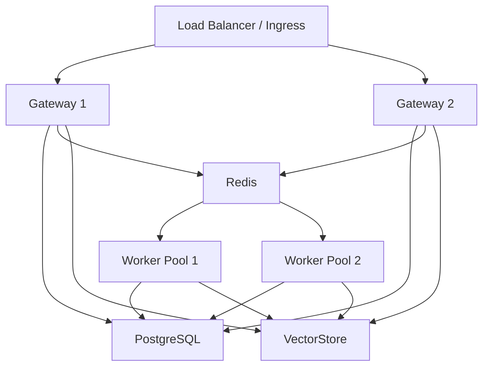

# MemStation — 集群与缓存设计文档

## 1. 目标

MemStation 当前以单机部署为默认落地形态，但必须支持未来平滑扩展到多实例集群，同时保持：

- 无状态 Gateway
- 稳定的 SSE 代理
- 低延迟记忆检索
- 缓存可失效、可观测、可降级

---

## 2. 集群拓扑



原则：

- Gateway 无状态
- Worker 无状态
- PostgreSQL、Redis、VectorStore 为共享状态层

---

## 3. SSE 与负载均衡

## 3.1 基本事实

SSE 流式请求在一次 HTTP 连接生命周期内天然绑定到接收它的实例。  
不需要把“全站会话粘性”当作前提，但必须保证：

- 连接不被中途切走
- 代理层不缓冲 SSE
- 关闭实例前先 drain 长连接

## 3.2 Nginx 基线示例

```nginx
location /v1/ {
    proxy_pass http://memstation_upstream;
    proxy_http_version 1.1;
    proxy_set_header Connection "";
    proxy_buffering off;
    proxy_cache off;
    proxy_read_timeout 300s;
    proxy_send_timeout 300s;
    chunked_transfer_encoding on;
}
```

说明：

- 不使用 NGINX Plus 专有 `health_check`
- 健康检查依赖通用的 readiness endpoint

---

## 4. 缓存架构

## 4.1 两级缓存


| 层级 | 存储 | 目标 |
|------|------|------|
| L1 | 进程内缓存 | 降低热点重复查询开销 |
| L2 | Redis | 跨实例共享短期结果 |

## 4.2 适合缓存的对象

- 用户设置
- Key Memory 列表
- 记忆检索短期结果
- 系统模型能力表

不建议缓存为强一致来源的对象：

- 对话消息明细
- 审计事件
- outbox 状态

## 4.3 TTL 原则

- TTL 仅用于性能优化
- 不能承载一致性语义
- 即使存在 Pub/Sub 失效广播，也必须保留 TTL

---

## 5. 缓存一致性

## 5.1 写路径

更新后流程：

1. 写数据库
2. 删除 L2 key
3. 发布失效事件
4. 各实例删除本地 L1

## 5.2 失效广播

推荐使用 Redis Pub/Sub：

- channel: `cache.invalidate`
- payload: cache key 列表

约束：

- 广播是最佳努力
- 广播失败时仍依赖 TTL 自然过期

---

## 6. 检索链路

记忆检索建议流程：

1. L1 查询
2. L2 查询
3. 生成 query embedding
4. VectorStore 召回
5. PostgreSQL 补全实体和关系
6. 时间衰减排序
7. 回填 L2 和 L1

说明：

- 不把最终排序完全写死在向量后端
- 关系补全与时间衰减属于业务层职责

---

## 7. 健康检查与弹性

必须提供：

- `/health/live`
- `/health/ready`

Readiness 至少检查：

- PostgreSQL
- Redis
- VectorStore
- outbox relay / scheduler 内部状态

---

## 8. 优雅关闭

关闭顺序：

1. 标记 `ready=false`
2. 停止接收新请求
3. 等待 in-flight SSE 结束
4. 再关闭 HTTP server

要求：

- graceful timeout 至少覆盖最长 SSE 超时
- 若超时仍有连接，则记录告警并强制退出

---

## 9. Kubernetes 基线

要求：

- Gateway 和 Worker 分开部署
- Gateway 至少配置 readiness / liveness
- 使用 rolling update
- 配置 preStop 或 terminationGracePeriod 保障连接 drain

不要求在本文档中给出大段 YAML，具体清单由部署文档维护。
