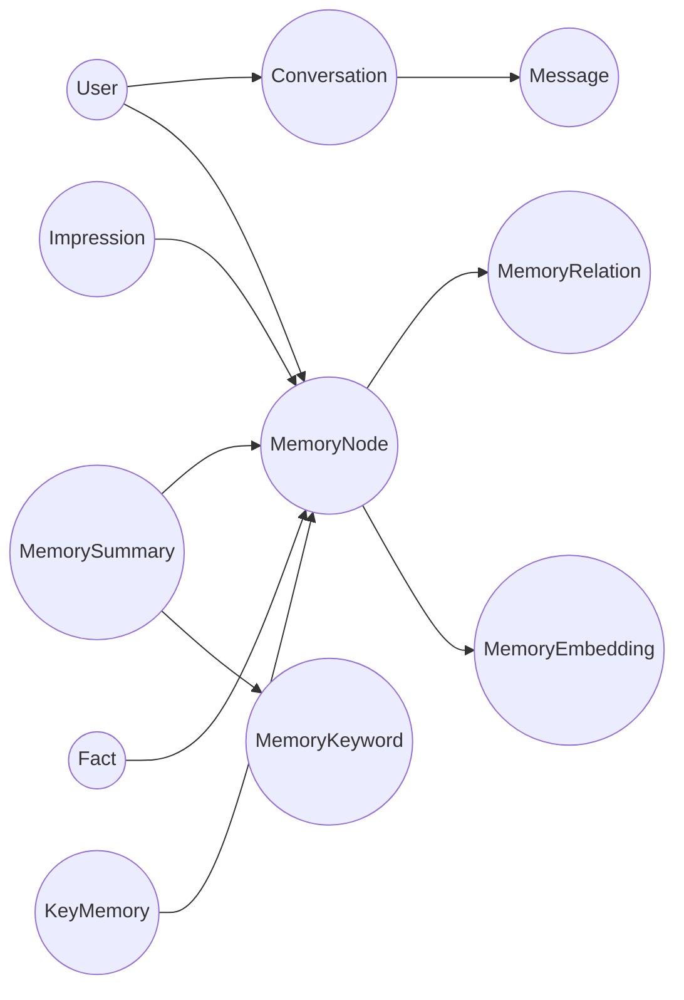

# MemStation — 数据库与图存储设计文档

## 1. 设计目标

MemStation 的记忆系统需要的是**高效、可控、可扩展的 Agent Memory Graph**，而不是通用图数据库语义。

高频访问模式非常明确：

1. 对 query 做 embedding，召回一批候选记忆。
2. 从候选记忆向外扩展 `1-2 hop` 关系邻域。
3. 把相关 summary / fact / impression / key memory 一起补全并重排。
4. 在管理面板中查看某个节点的本地子图。

因此，v1.0 采用：

- PostgreSQL 存关系与图层
- pgvector 作为默认向量索引
- Ent 管理业务实体与图层 schema
- `MemoryNode + MemoryRelation + MemoryEmbedding` 统一图层

---

## 2. 为什么 PostgreSQL 足够

MemStation 的图查询不是无界深度遍历，而是：

- **用户隔离**：所有查询都先按 `user_id` 收敛
- **候选驱动**：先向量召回，再图扩展
- **深度有界**：在线热路径默认最多 `2 hop`
- **节点类型有限**：Summary / Fact / Impression / KeyMemory
- **边语义有限**：关系类型和权重明确

只要建模正确，PostgreSQL 的：

- B-Tree 索引
- pgvector ANN 索引
- join 查询
- `WITH RECURSIVE`

就足以支持高效图存储和图查找。

---

## 3. 总体存储分层

## 3.1 关系层

PostgreSQL 存储：

- 用户、认证、配置
- 会话与消息
- 记忆业务实体
- 统一图节点与图边
- 审计事件
- outbox 事件

## 3.2 向量层

向量层统一抽象为 `MemoryEmbedding`：

- 默认使用 PostgreSQL + pgvector
- 可切换到 Qdrant / Milvus
- 统一以 `node_id` 为对象标识

要求：

- 记录 embedding 版本
- 支持按 `user_id` 和 `node_type` 过滤
- 支持重嵌入和分批删除

---

## 4. 统一图层模型

## 4.1 设计原则

业务实体仍然保留各自表：

- `memory_summaries`
- `impressions`
- `facts`
- `key_memories`

但所有记忆实体都必须一对一映射到统一图节点表：

- `memory_nodes`

所有关系边都必须写入统一边表：

- `memory_relations`

所有向量都必须挂到统一向量对象：

- `memory_embeddings`

收益：

- 图扩展只扫一张边表
- 向量召回只返回 `node_id`
- 图查询不会被多张隐式 join table 撕裂
- 节点类型扩展不会破坏图查询逻辑

## 4.2 逻辑结构



---

## 5. 实体定义

## 5.1 User / APIKey / UserSetting / Conversation / Message

这些实体承担基础业务功能：

- `User`
- `APIKey`
- `UserSetting`
- `Conversation`
- `Message`

要求：

- 全部显式关联 `user_id`
- `Message` 必须支持 `content_blocks`、`tool_calls`、`tool_result`

## 5.2 MemoryNode

`MemoryNode` 是统一图节点。

关键字段：

| 字段 | 说明 |
|------|------|
| `id` | 节点主键 |
| `user_id` | 用户隔离键 |
| `node_type` | `summary` / `impression` / `fact` / `key_memory` |
| `entity_id` | 指向业务实体主键 |
| `importance` | 重要性 |
| `decay_factor` | 时间衰减参数 |
| `embedding_status` | `pending` / `ready` / `failed` |
| `created_at` | 创建时间 |
| `updated_at` | 更新时间 |

索引：

- unique `(user_id, node_type, entity_id)`
- index `(user_id, node_type, created_at desc)`
- index `(user_id, embedding_status, created_at desc)`

## 5.3 MemoryRelation

`MemoryRelation` 是统一图边表。

关键字段：

| 字段 | 说明 |
|------|------|
| `id` | 边主键 |
| `user_id` | 用户隔离键 |
| `src_node_id` | 源节点 |
| `dst_node_id` | 目标节点 |
| `relation_type` | `about` / `supports` / `contradicts` / `derived_from` / `supersedes` 等 |
| `weight` | 关系强度 |
| `source` | `summary` / `analysis` / `manual` / `tool` |
| `metadata` | 边附加信息 |
| `created_at` | 创建时间 |

索引：

- unique `(user_id, src_node_id, dst_node_id, relation_type)`
- index `(user_id, src_node_id, relation_type, weight desc)`
- index `(user_id, dst_node_id, relation_type, weight desc)`
- index `(user_id, relation_type, created_at desc)`

## 5.4 MemoryEmbedding

`MemoryEmbedding` 是统一向量层对象。

关键字段：

| 字段 | 说明 |
|------|------|
| `embedding_id` | 主键 |
| `user_id` | 用户隔离键 |
| `node_id` | 对应 `MemoryNode.id` |
| `node_type` | 节点类型，便于过滤 |
| `embedding_version` | 嵌入版本 |
| `embedding_model` | 部署级模型名 |
| `content_hash` | 内容哈希 |
| `vector` | 向量值 |
| `created_at` | 创建时间 |
| `updated_at` | 更新时间 |

索引：

- unique `(user_id, node_id, embedding_version)`
- btree `(user_id, node_type, embedding_version)`
- ANN index on `vector`

## 5.5 MemorySummary

关键字段：

- `id`
- `user_id`
- `conversation_id`
- `node_id` unique
- `summary`
- `topic_label`
- `summary_version`
- `chunk_index`
- `chunk_total`
- `created_at`
- `updated_at`

## 5.6 Impression

关键字段：

- `id`
- `user_id`
- `conversation_id`
- `node_id` unique
- `subject`
- `subject_type`
- `evaluation`
- `sentiment`
- `familiarity`
- `description`

## 5.7 Fact

关键字段：

- `id`
- `user_id`
- `conversation_id`
- `node_id` unique
- `category`
- `subject`
- `content`
- `confidence`
- `is_superseded`
- `superseded_by_id`

## 5.8 KeyMemory

关键字段：

- `id`
- `user_id`
- `node_id` unique
- `key`
- `value`
- `category`
- `source`
- `review_status`

## 5.9 MemoryKeyword

关键词保留为 Summary 子表，不单独成为图节点。  
它用于标签、检索辅助和摘要展示，不承担统一图遍历职责。

---

## 6. Ent 建模策略

## 6.1 推荐方案

Ent 中显式建模：

- `MemoryNode`
- `MemoryRelation`

并让：

- `MemorySummary -> node`
- `Impression -> node`
- `Fact -> node`
- `KeyMemory -> node`

全部是一对一关系。

## 6.2 不推荐方案

不再采用以下做法作为主方案：

- Summary/Fact/Impression 之间全部使用分散的隐式 many-to-many edge
- 让图查询依赖多张不同 join table 做运行时拼接

原因：

- 查询路径不可控
- 索引碎片化
- 新增节点类型后复杂度指数上升

---

## 7. 高频查询模式

## 7.1 向量召回

流程：

1. 对 query 生成 embedding
2. 在 `memory_embeddings` 中按 `user_id + node_type` 过滤
3. 召回 Top K `node_id`

返回：

- `node_id`
- `semantic_score`

## 7.2 1-hop 邻域扩展

在线热路径默认只做 1-hop：

```sql
SELECT r.dst_node_id, r.relation_type, r.weight
FROM memory_relations r
WHERE r.user_id = $1
  AND r.src_node_id = ANY($2)
ORDER BY r.weight DESC
LIMIT $3;
```

这条查询的效率核心来自：

- `user_id` 限定
- `src_node_id` 精准命中
- 邻接索引覆盖

## 7.3 2-hop 有界扩展

当需要补更多上下文时，可以使用有界递归：

```sql
WITH RECURSIVE walk AS (
  SELECT
    r.src_node_id,
    r.dst_node_id,
    r.relation_type,
    r.weight,
    1 AS depth
  FROM memory_relations r
  WHERE r.user_id = $1
    AND r.src_node_id = ANY($2)

  UNION ALL

  SELECT
    r.src_node_id,
    r.dst_node_id,
    r.relation_type,
    r.weight,
    w.depth + 1
  FROM memory_relations r
  JOIN walk w ON r.src_node_id = w.dst_node_id
  WHERE r.user_id = $1
    AND w.depth < 2
)
SELECT * FROM walk;
```

规则：

- 在线热路径深度上限 `2`
- 必须设置节点数和边数上限
- 不允许无界递归

## 7.4 实体补全

拿到 `node_id` 后，按 `node_type` 批量补全业务实体：

- summary 节点补全 `memory_summaries`
- fact 节点补全 `facts`
- impression 节点补全 `impressions`
- key memory 节点补全 `key_memories`

这一步是批量查询，不是逐节点 N+1。

---

## 8. 排序模型

最终排序公式：

```text
final_score =
  semantic_score
  × node_importance
  × time_decay
  × relation_boost
```

其中：

- `semantic_score` 来自向量召回
- `node_importance` 来自 `memory_nodes.importance`
- `time_decay` 来自 `memory_nodes.decay_factor`
- `relation_boost` 来自 `memory_relations.weight`

原则：

- 图扩展用于补上下文
- 最终排序统一由业务层计算

---

## 9. 写入路径

## 9.1 Summary

写入顺序：

1. 创建 `memory_summaries`
2. 创建 `memory_nodes`
3. 创建 `memory_keywords`
4. 写 outbox -> embedding / analysis

## 9.2 Impression / Fact

写入顺序：

1. 创建业务实体
2. 创建 `memory_nodes`
3. 写入 `memory_relations`
4. 触发 embedding / key memory

## 9.3 KeyMemory

写入顺序：

1. Upsert `key_memories`
2. 创建或复用 `memory_nodes`
3. 写入必要关系边

---

## 10. 多用户隔离

以下三张图层表必须全部带 `user_id`：

- `memory_nodes`
- `memory_relations`
- `memory_embeddings`

所有索引也必须优先包含 `user_id`。  
这样可以保证：

- 数据局部性更好
- 邻域扩展不会跨用户污染
- GraphQL 和 Agent 工具查询天然有边界

---

## 11. 扩展策略

## 11.1 升级 embedding model

升级流程：

1. 新增 `embedding_version`
2. 批量重建 `memory_embeddings`
3. 切换读流量到新版本
4. 延迟清理旧版本

## 11.2 新增节点类型

新增节点类型时：

- 增加业务实体表
- 增加 `node_type`
- 图查询逻辑保持不变

## 11.3 切换外部 VectorStore

切换到 Qdrant / Milvus 时：

- `memory_nodes` 和 `memory_relations` 不变
- 只替换 `MemoryEmbedding` 存储实现

---

## 12. 结论

底层图存储要高效，必须同时满足四个条件：

1. 统一节点表。
2. 统一边表。
3. 统一向量对象以 `node_id` 作为检索入口。
4. 在线查询始终保持 `user_id + candidate node set + depth<=2` 的约束。

在这个边界内，PostgreSQL + Ent + pgvector 完全可以实现高效率的图存储和图查找。
