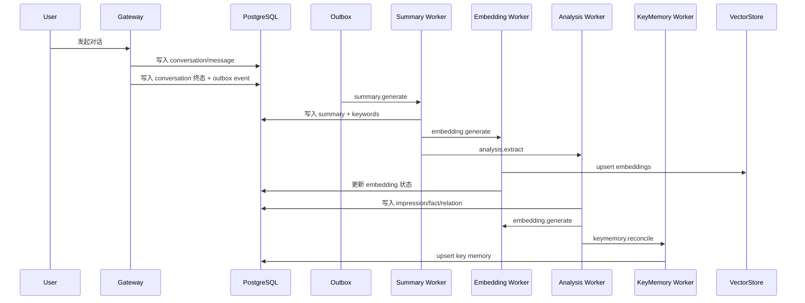

# MemStation — 记忆系统设计文档

## 1. 目标

MemStation 的记忆系统负责将用户对话转化为可检索、可排序、可注入、可管理的长期记忆。

v1.0 记忆系统包含五个子域：

1. 主记忆 `MemorySummary`
2. 关键词 `MemoryKeyword`
3. 印象 `Impression`
4. 事实 `Fact`
5. Key Memory `KeyMemory`

---

## 2. 生命周期



---

## 3. 对话终止判定

系统必须支持以下终止触发器：

| 触发器 | 说明 | 默认值 |
|--------|------|--------|
| 显式结束 | Header 或请求参数表明本轮结束 | 手动触发 |
| 超时结束 | 最后一条消息后 N 分钟无新消息 | 15 分钟 |
| 消息阈值 | 对话消息数达到阈值 | 50 |
| Token 阈值 | 对话累计 Token 达到阈值 | 32000 |

要求：

- 同一对话只能进入一次“终止处理中”状态
- timeout 和 explicit end 必须可去重
- 终止状态变化要写审计或系统事件

---

## 4. 主记忆系统

## 4.1 Summary 生成

Summary Worker 输入：

- `conversation_id`
- `user_id`
- `finalize_reason`
- `summary_version`

输出：

- 一条或多条 `MemorySummary`
- 对应 `MemoryKeyword`
- 对应 `MemoryNode`
- 后续向量化任务

## 4.2 长对话分片

当对话超出摘要模型可接受上下文时，必须切片：

- 以 token 为主
- 以消息边界切分
- 支持片间重叠

默认建议：

- `chunk_max_tokens = 6000`
- `chunk_overlap_tokens = 600`

## 4.3 多主题拆解

当单次对话存在多个强独立主题时，Summary Worker 必须拆分为多个摘要。

输出要求：

- 每个摘要只聚焦一个主题
- 每个摘要有独立 `topic_label`
- 每个摘要后续独立向量化

## 4.4 Summary 结构化输出

模型输出至少包含：

- `summary`
- `topic_label`
- `keywords`
- `importance`
- `decay_factor`

约束：

- 输出必须为严格 JSON
- 服务端负责 JSON schema 校验

---

## 5. 印象系统

## 5.1 定义

印象表示用户对某个主体的主观态度与认知，例如：

- 喜欢 / 讨厌
- 熟悉 / 不熟悉
- 信任 / 不信任
- 积极 / 消极 / 复杂

## 5.2 生成方式

Analysis Worker 可采用受控 ReAct 或单轮结构化抽取。

v1.0 约束：

- 最大工具轮次 `2-3`
- 必须设置总 token budget
- 必须设置单任务超时
- 如果 ReAct 失败，回退到单轮抽取

## 5.3 可用工具

只允许读取类工具：

- `search_memories`
- `get_impressions`
- `get_facts`
- `get_key_memory`
- `get_conversation_detail`

Analysis 阶段不允许直接写 Key Memory。

Analysis 产生的所有语义关系必须写入统一 `MemoryRelation`。

---

## 6. 事实系统

## 6.1 定义

事实表示与用户强相关、可长期保留的客观信息。

保留条件：

- 与用户本人或其稳定关系网络密切相关
- 具备相对确定性
- 对后续对话有长期价值

## 6.2 事实分类

推荐分类：

- relationship
- family
- psychology
- finance
- health
- work
- study
- location
- other

## 6.3 事实替代

新事实与旧事实冲突时：

- 旧事实标记 `is_superseded=true`
- 新事实写入 `supersedes` / `superseded_by` 关系
- 保留历史，不做物理覆盖

---

## 7. Key Memory 系统

## 7.1 定义

Key Memory 用于保存用户稳定环境信息，便于注入时提供上下文稳定性。

适合进入 Key Memory 的信息：

- 姓名
- 时区
- 常用语言
- 所在地
- 职业
- 设备偏好
- 长期偏好

## 7.2 白名单策略

写工具和自动提取都必须遵守键白名单，例如：

```text
user.name
user.location
user.timezone
user.language
user.occupation
user.preference.*
user.device.*
```

## 7.3 Upsert 规则

- `(user_id, key)` 唯一
- 自动抽取写入 `source=auto`
- 人工修改写入 `source=manual`
- 工具写入写入 `source=tool`
- 工具写入和人工修改都必须写 `AuditEvent`
- 每条 Key Memory 必须有对应 `MemoryNode`

---

## 8. 属性、事实、印象判定规则

| 类型 | 判定依据 | 示例 |
|------|----------|------|
| Key Memory | 用户稳定属性 | “我在上海工作” |
| Fact | 与用户强相关的客观事实 | “我姐姐在东京生活” |
| Impression | 用户主观感受或评价 | “我很喜欢日本文化” |

边界规则：

- 易变且短期的情绪通常不进 Key Memory
- 纯世界知识不进入 Fact，除非与用户强相关
- 不确定推测不进入 Fact

---

## 9. 排序与衰减

## 9.1 排序公式

最终得分：

```text
effective_score = semantic_score × importance × time_decay
```

其中：

- `semantic_score` 由向量召回给出
- `importance` 由生成阶段估计
- `time_decay` 根据时间与 `decay_factor` 计算

## 9.2 注入优先级

默认优先级：

1. Key Memory
2. 高分 Summary
3. 高分 Fact
4. 高分 Impression

## 9.3 Token 预算

注入必须受 `max_injection_tokens` 控制：

- 先装配候选
- 再按优先级裁剪
- 最终保证不突破模型预算

---

## 10. 注入格式

## 10.1 System Prompt 注入

推荐结构：

```text
[Memory Context]
User Profile:
- name: ...
- location: ...
- timezone: ...

Relevant Memories:
1. ...
2. ...

Relevant Facts:
- ...

Relevant Impressions:
- ...

Use these naturally. Do not explicitly say you remembered them unless asked.
[/Memory Context]
```

## 10.2 Tool Injection

v1.0 推荐只读工具：

- `recall_memory`
- `get_key_memory`

写工具要求：

- 默认关闭
- 只允许写入白名单键
- 必须通过服务端校验
- 必须生成审计事件

---

## 11. 失败与回退策略

当任一步骤失败时：

- Summary 失败：允许重试，不阻塞原始对话保留
- Embedding 失败：实体保留，状态标记为未嵌入
- Analysis 失败：不阻塞 Summary 生效
- Key Memory 失败：不影响主记忆和事实写入

原则：

- 主链路优先保全数据
- 智能分析允许降级
- 每一阶段都必须有可重放入口

---

## 12. 评测与召回准确率

记忆系统的功能设计之外，还需要独立的评测体系来验证：

- 抽取是否正确
- Recall / Ranking 是否稳定
- superseded fact 是否被正确压制
- 注入后回答是否变好且不引入错误记忆

具体方案已单独落到 `~/Projects/memstation/.plan/memory-evaluation.md`。
