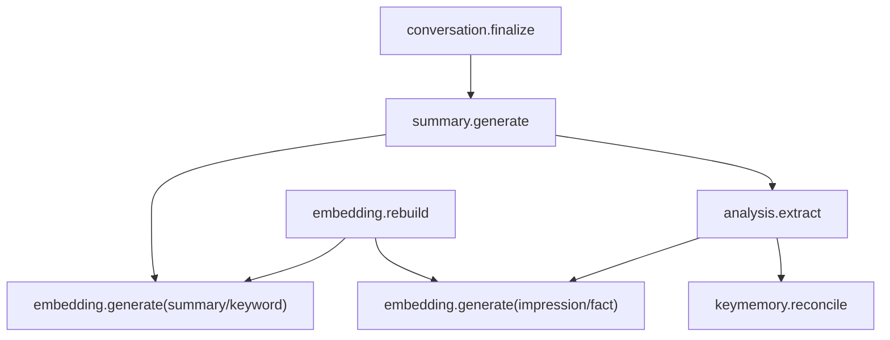

# MemStation — 队列与 Worker 设计文档

## 1. 设计目标

MemStation 使用 `asynq` 处理所有异步任务。  
完整版本必须同时满足：

- 高可用
- 幂等
- 可重试
- 可观测
- 可回放

最关键约束：

- 任务进入 asynq 前，必须先写入 `OutboxEvent`
- 不能只靠“事务提交后立即 enqueue”

---

## 2. 任务流设计

## 2.1 核心任务类型

```go
const (
    TypeConversationFinalize = "conversation.finalize"
    TypeSummaryGenerate      = "summary.generate"
    TypeEmbeddingGenerate    = "embedding.generate"
    TypeAnalysisExtract      = "analysis.extract"
    TypeKeyMemoryReconcile   = "keymemory.reconcile"
    TypeEmbeddingRebuild     = "embedding.rebuild"
)
```

## 2.2 流程关系



---

## 3. Outbox Relay

## 3.1 作用

Outbox Relay 负责把数据库中的 `OutboxEvent` 转换成 asynq 任务。

流程：

1. 业务事务写入实体 + `OutboxEvent`
2. 提交事务
3. Relay 轮询未处理事件
4. Relay enqueue 到 asynq
5. 标记 `OutboxEvent.processed_at`

## 3.2 约束

- Relay 必须支持重复扫描
- enqueue 成功后再标记 processed
- enqueue 失败时增加 `retry_count`

---

## 4. 队列划分

推荐队列：

```go
const (
    QueueCritical = "critical"
    QueueDefault  = "default"
    QueueLow      = "low"
    QueueBulk     = "bulk"
)
```

建议映射：

| 任务 | 队列 |
|------|------|
| `conversation.finalize` | `critical` |
| `summary.generate` | `default` |
| `embedding.generate` | `default` |
| `analysis.extract` | `low` |
| `keymemory.reconcile` | `low` |
| `embedding.rebuild` | `bulk` |

---

## 5. Worker 设计

## 5.1 Summary Worker

职责：

- 读取对话消息
- 按阈值分片
- 生成一个或多个 `MemorySummary`
- 提取 `MemoryKeyword`
- 发送 embedding / analysis 任务

Payload：

```go
type SummaryPayload struct {
    ConversationID string `json:"conversation_id"`
    UserID         string `json:"user_id"`
    SummaryVersion int    `json:"summary_version"`
    FinalizeReason string `json:"finalize_reason"`
}
```

幂等键建议：

- `summary.generate:<conversation_id>:<summary_version>`

## 5.2 Embedding Worker

职责：

- 读取待嵌入实体
- 计算 embedding
- upsert 到 VectorStore
- 更新实体 `embedding_status`

Payload：

```go
type EmbeddingPayload struct {
    UserID           string `json:"user_id"`
    NodeID           string `json:"node_id"`
    NodeType         string `json:"node_type"`
    EmbeddingVersion int    `json:"embedding_version"`
}
```

约束：

- 只从数据库读取内容，不信任 payload 里的文本副本
- 必须比较 `content_hash`，避免过时任务覆盖新内容
- 向量始终以 `node_id` 为挂载对象

## 5.3 Analysis Worker

职责：

- 基于 summary 和对话生成 Impression / Fact
- 建立关系边
- 触发 impression / fact 的 embedding
- 触发 Key Memory 更新

Payload：

```go
type AnalysisPayload struct {
    UserID         string `json:"user_id"`
    ConversationID string `json:"conversation_id"`
    SummaryIDs     []string `json:"summary_ids"`
}
```

运行约束：

- 最大工具轮次 `2-3`
- 超时必须可配置
- 失败时回退为单轮结构化抽取

## 5.4 Key Memory Worker

职责：

- 从对话、Summary、Fact 中提取 Key Memory 候选
- 按白名单过滤
- Upsert `KeyMemory`
- 生成审计事件

约束：

- `(user_id, key)` 唯一
- 必须保留写入来源

## 5.5 Rebuild Worker

职责：

- 在 embedding model 升级后批量重建向量
- 支持分批执行和进度跟踪

---

## 6. 幂等与去重

所有任务必须遵循：

- 业务幂等
- asynq 唯一任务键
- 可安全重试

去重来源：

- 同一 conversation 被多次终止
- relay 重复扫描同一个 outbox 事件
- worker 执行超时后被重试

实现要求：

- 任务处理前检查当前阶段状态
- 已完成阶段直接返回成功

---

## 7. 重试策略

| 任务 | 最大重试 | 退避 |
|------|----------|------|
| `conversation.finalize` | 5 | 指数退避 |
| `summary.generate` | 3 | 指数退避 |
| `embedding.generate` | 5 | 指数退避 |
| `analysis.extract` | 2 | 固定长退避 |
| `keymemory.reconcile` | 3 | 指数退避 |
| `embedding.rebuild` | 10 | 指数退避 |

说明：

- 长耗时智能任务重试次数不宜过高
- 可回放比盲目重试更重要

---

## 8. 调度任务

## 8.1 对话超时扫描

周期：

- 每 1 分钟扫描活跃会话

动作：

- 将超时会话从 `active` 置为 `ending`
- 写入 `OutboxEvent`

## 8.2 Outbox Relay

周期：

- 高频轮询，例如 `1s-3s`

动作：

- 把待处理 outbox 投递到 asynq

## 8.3 Backfill / Rebuild

周期：

- 手动触发优先
- 大规模重建可批处理调度

---

## 9. 监控要求

必须观测：

- 队列大小
- 任务等待时间
- 任务处理耗时
- 任务失败率
- 死信数量
- outbox 未处理积压

必须暴露：

- OTLP telemetry export
- 管理接口任务概览

---

## 10. 启动方式

```bash
# HTTP 服务
memstation serve

# Worker
memstation worker --all

# Scheduler + Outbox Relay
memstation scheduler

# 单任务类型调试
memstation worker --type summary.generate
```
