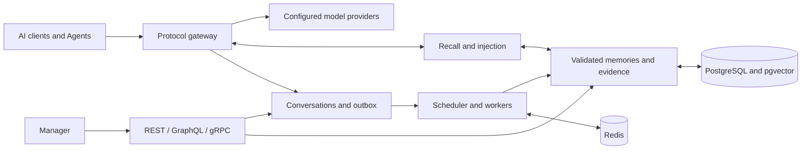

<div align="center">
  <picture>
    <source media="(prefers-color-scheme: dark)" srcset="apps/manager/static/brand/memstation-dark.png" />
    
  </picture>
  <h1>MemStation</h1>
  <p><strong>A gateway for your models. A home for your memory.</strong></p>
  <p>Self-hosted AI gateway, long-term memory and a dashboard to inspect it all.</p>
  <p>
    <a href="LICENSE"></a>
    <a href="https://github.com/backrunner/memstation/actions/workflows/ci.yml"></a>
    <a href="apps/server/go.mod"></a>
    <a href="apps/manager/package.json"></a>
  </p>
  <p>English &nbsp; <a href="README.zh-CN.md">简体中文</a></p>
  <p><a href="#quick-start">Quick start</a> &nbsp; <a href="#how-memory-works">Memory lifecycle</a> &nbsp; <a href="#documentation">Documentation</a> &nbsp; <a href="CONTRIBUTING.md">Contribute</a></p>
</div>

MemStation connects AI clients to model providers and carries useful context from
one conversation to the next. Keep the conversations, inspect what became a memory,
correct it when needed, and control how it is recalled.

**Current scope:** personal self-hosting, a single instance and Personal workspaces.
Multiple Agents can share a service with scoped credentials. Group-chat ingestion,
other workspace kinds, organizations and billing are still on the roadmap.
Production-scale performance validation is ongoing.

<a href="docs/assets/manager-preview.png"></a>
<p align="center"><sub>Current Manager UI, captured from synthetic repository fixtures.</sub></p>

## Why MemStation

| Capability | What you get |
| --- | --- |
| **One client endpoint** | OpenAI Chat Completions, Responses and Anthropic Messages, with streaming and non-streaming requests. Route to OpenAI-compatible providers, Anthropic or Gemini. |
| **Memory with evidence** | LLM-generated summaries, facts, impressions and Key Memory, plus events, tasks, procedures, artifacts and entities. Preserve source references and fact history. |
| **Configurable recall** | Vector candidates, bounded graph expansion and semantic relevance × importance × time decay. Inject context or expose memory tools. |
| **Human control** | Browse conversations, edit memories, inspect relations, manage Agents, configure models, track usage and retry background jobs. |
| **Your infrastructure** | PostgreSQL with pgvector, Redis, encrypted provider credentials, hashed API keys, transactional outbox, retryable workers and OTel/OTLP telemetry. |

Use hosted models, an OpenAI-compatible local endpoint such as Ollama, or a mixture
of cloud text generation and local embeddings. Models are configurable; **summary,
analysis and embedding models must be configured** for automatic memory generation.
Model failures retry instead of producing rule-based semantic memories.

<details>
<summary><strong>Explore workspace memory on desktop and mobile</strong></summary>

Browse, filter and correct records within the selected workspace.


Screenshots use synthetic fixtures, not private conversations. [Reproduce them locally](docs/assets/README.md).

</details>

## How memory works



1. Gateway normalizes requests, recalls context and persists conversations and usage.
2. Finalization writes an outbox event. Scheduler and workers generate summaries,
   analyze facts and impressions, consolidate Key Memory and create embeddings.
3. Server-side validation checks structure, scope and source citations. Checkpoints
   make retries repeatable; version checks protect manual corrections.
4. Later requests retrieve memories within their authorized scope. Manager exposes
   the source, history and editing controls.

The Go server ships as one binary with `serve`, `worker`, `scheduler`, `migrate` and
`seed` roles. SvelteKit Manager runs separately with encrypted server-side sessions.
See [architecture](docs/architecture.md), [LLM generation](docs/llm-memory.md) and
[graph memory](docs/graph-memory.md) for details and current limits.

## Quick start

For the development workflow, install Docker with Compose, Node.js **26.12.1** and
pnpm **12.15.0**. The devcontainer supplies Go **1.27.3**.

```bash
git clone https://github.com/backrunner/memstation.git
cd memstation
pnpm install --frozen-lockfile
pnpm dev
```

1. Open **http://127.0.0.1:5173** and connect to **http://127.0.0.1:8080**.
2. The devcontainer's local admin token is `memstation-local-admin-token`, unless
   overridden with `MEMSTATION_ADMIN_TOKEN`.
3. Configure provider credentials and chat, summary, analysis and embedding models.
   Seed or create a user and a MemStation API key.
4. Start `worker` and `scheduler` when testing automatic memories. `pnpm dev`
   starts infrastructure, migrations, `serve` and Manager; it does not start workers.

**Want the whole stack, including workers?** Follow the
[non-destructive Compose startup](deploy/compose/DEVELOPMENT.md#start-a-full-local-stack).
For Apple Container or local HTTPS, see [local debugging](docs/local-debugging.md).
Development defaults are for loopback access. Configure unique secrets, TLS, secure
cookies and CORS before exposing an instance; see [security](SECURITY.md).

## Connect a client

Use `http://127.0.0.1:8080/v1` as the OpenAI-compatible base URL. Authenticate with a
**MemStation API key**, not a provider credential. Use a model configured on your instance:

```bash
export MEMSTATION_API_KEY='your-memstation-api-key'
export MEMSTATION_MODEL='your-configured-model'

curl http://127.0.0.1:8080/v1/chat/completions \
  -H "Authorization: Bearer $MEMSTATION_API_KEY" \
  -H 'Content-Type: application/json' \
  -d "{\"model\":\"$MEMSTATION_MODEL\",\"messages\":[{\"role\":\"user\",\"content\":\"Remember that I prefer concise answers.\"}]}"
```

| Interface | Entry points |
| --- | --- |
| Gateway | `/v1/chat/completions`, `/v1/responses`, `/v1/messages`, `/v1/models` |
| Memory REST | `/api/v1/memory/search`, `/api/v1/memory/keys` |
| Management | Admin REST and GraphQL Query/Mutation |
| gRPC | Gateway, Memory, Admin and Health; [protobuf definitions](apps/server/proto/memstation/v1/api.proto) |
| Health | `/health/live`, `/health/ready` |

## Documentation

| Start here | Reference |
| --- | --- |
| Develop and contribute | [Local workflows](docs/local-debugging.md), [contribution guide](CONTRIBUTING.md), [engineering specification](AGENTS.md) |
| Configure Manager | [Service connections, sessions and network policy](docs/manager-connections.md) |
| Understand memory | [Architecture](docs/architecture.md), [LLM generation](docs/llm-memory.md), [graph and fact history](docs/graph-memory.md) |
| Workspaces and Agents | [Implementation status and integration plan](docs/plans/workspace-agents/README.md); only Personal workspaces are enabled |
| Verify behavior | [CI and testing](docs/ci.md), [retrieval evaluation](apps/server/tests/eval/README.md) |
| Deploy and operate | [Compose](deploy/compose/DEVELOPMENT.md), [Kubernetes baseline](deploy/k8s), [Nginx](deploy/nginx), [telemetry](deploy/otel), [backup and restore](deploy/compose/BACKUP_RESTORE.md) |
| Open-source scope | [Publication audit and licensing boundaries](docs/open-source.md), [third-party notices](THIRD_PARTY_NOTICES.md) |

Retrieval benchmarks are manual diagnostic runs, outside default CI/nightly gates.
Native golden data ships in the repository; external LOCOMO and LongMemEval datasets
are downloaded separately. Deterministic test vectors demonstrate the evaluation
pipeline, not real-model retrieval quality.

## Contribute

[Report a bug](https://github.com/backrunner/memstation/issues/new/choose), suggest an
improvement or send a focused pull request. Include reproducible steps and fixture
data; see [CONTRIBUTING.md](CONTRIBUTING.md). Report vulnerabilities
[privately](https://github.com/backrunner/memstation/security/advisories/new).

## License

[Apache License 2.0](LICENSE), with [NOTICE](NOTICE) and
[third-party notices](THIRD_PARTY_NOTICES.md). The license permits commercial use,
modification and redistribution under its terms and includes an express patent grant.
See the [official license text](https://www.apache.org/licenses/LICENSE-2.0).

Bundled fonts retain SIL OFL 1.1. Dependencies retain their own licenses. Model weights
and hosted model access are not included. External LOCOMO data is CC BY-NC 4.0 and
is neither bundled nor relicensed under Apache-2.0.
