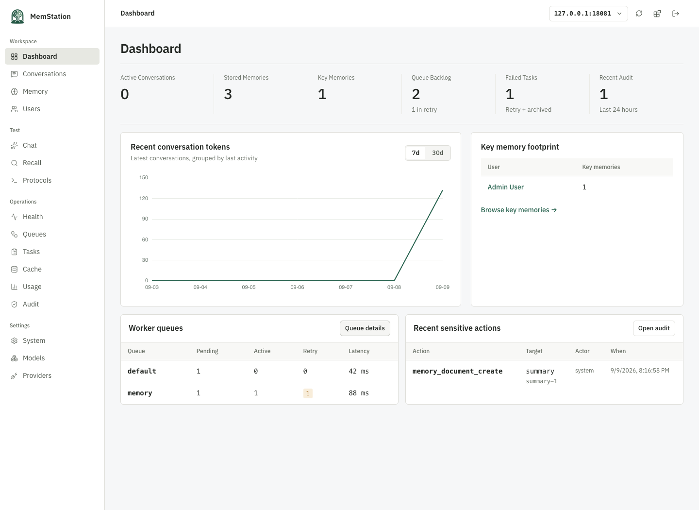
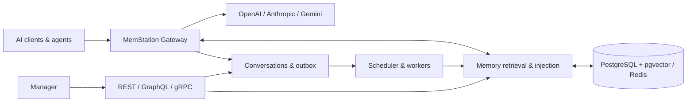

<div align="center">
  <picture>
    <source media="(prefers-color-scheme: dark)" srcset="apps/manager/static/brand/memstation-dark.png" />
    
  </picture>
  <h1>MemStation</h1>
  <p><strong>One gateway. Lasting memory. Your infrastructure.</strong></p>
  <p>A self-hosted AI gateway, persistent memory system and operations dashboard.</p>
  <p>
    <a href="https://github.com/backrunner/memstation/actions/workflows/ci.yml"></a>
    <a href="LICENSE"></a>
    <a href="apps/server/go.mod"></a>
    <a href="apps/manager/package.json"></a>
  </p>
  <p>English · <a href="README.zh-CN.md">简体中文</a></p>
  <p><a href="#quick-start">Quick start</a> · <a href="docs/architecture.md">Architecture</a> · <a href="CONTRIBUTING.md">Contributing</a> · <a href="docs/ci.md">CI & testing</a></p>
</div>

---

MemStation gives your AI clients a shared gateway and a memory layer that survives
individual conversations. Route requests to multiple providers, retrieve relevant
context for the next turn, and inspect conversations, memories, usage and background
jobs from one Manager.

It is designed for **personal self-hosting and a single instance first**. The v1 code
baseline is implemented; production-scale latency validation and operational tuning
are ongoing. Organizations, billing and cluster deployment remain future work.


<p align="center"><sub>Manager dashboard · repository fixture data</sub></p>

## What you can do

| | Capabilities |
| --- | --- |
| **Connect your clients** | OpenAI Chat Completions, OpenAI Responses and Anthropic Messages; streaming and non-streaming; OpenAI, Anthropic and Gemini upstreams. |
| **Keep useful context** | Summaries, facts, impressions, Key Memory, events, tasks, procedures, artifacts and entities, with source evidence and version history. |
| **Recall across conversations** | Vector search, bounded graph expansion and ranking by semantic relevance × importance × time decay; configurable context and tool injection. |
| **Inspect and correct** | Browse conversations, edit memories, manage users and provider settings, inspect usage and costs, retry jobs and review audit events. |
| **Operate your own stack** | Transactional outbox, retryable workers, encrypted upstream credentials, hashed API keys, OTel/OTLP, health checks and backup/restore drills. |

## How it fits together



The Go server is the business core, delivered as one binary with `serve`, `worker`,
`scheduler`, `migrate` and `seed` roles. Manager is an independently deployed SvelteKit
app. See the [capability reference](docs/architecture.md) for memory lifecycle,
generation isolation, fact lineage and management interfaces.

## Quick start

For local development, install Docker with Compose, Node.js and **pnpm 12.15.0**.
CI uses Node.js **26.12.1** and Go **1.27.3**; the devcontainer supplies the Go toolchain.

```bash
git clone https://github.com/backrunner/memstation.git
cd memstation
pnpm install --frozen-lockfile
pnpm dev
```

This starts PostgreSQL and Redis, applies migrations and runs the server and Manager
with reload support inside a devcontainer. The devcontainer CLI is fetched at a pinned
version if it is not already installed.

1. Open Manager at **http://127.0.0.1:5173**.
2. Connect to **http://127.0.0.1:8080** using the local development admin token
   `memstation-local-admin-token`, or your `MEMSTATION_ADMIN_TOKEN` override.
3. Configure provider credentials and chat, summary, analysis and embedding models in
   Settings. Model names are configuration, not hardcoded defaults.
4. Seed or create a user/API key. Run the `worker` and `scheduler` roles when testing
   automatic memory generation; the hot-reload command starts `serve` and Manager.

The gRPC endpoint is **127.0.0.1:9090**. For a full Compose stack including workers,
use the [development stack guide](deploy/compose/DEVELOPMENT.md). Its reset command
removes the selected project's database and Redis volumes; use it only for disposable
development data. Apple Container and HTTPS Portless flows are documented in the
[local debugging guide](docs/local-debugging.md).

## Connect an AI client

Point an OpenAI-compatible client at `http://127.0.0.1:8080/v1` and use a **MemStation
API key**. Provider credentials stay in MemStation. Use a model configured on your instance:

```bash
export MEMSTATION_API_KEY='your-memstation-api-key'
export MEMSTATION_MODEL='your-configured-model'

curl http://127.0.0.1:8080/v1/chat/completions \
  -H "Authorization: Bearer $MEMSTATION_API_KEY" \
  -H 'Content-Type: application/json' \
  -d "{\"model\":\"$MEMSTATION_MODEL\",\"messages\":[{\"role\":\"user\",\"content\":\"Remember that I prefer concise answers.\"}]}"
```

| Interface | Entry points |
| --- | --- |
| Gateway | `/v1/chat/completions`, `/v1/responses`, `/v1/messages`, `/v1/models` |
| Memory REST | `/api/v1/memory/search`, `/api/v1/memory/keys` |
| Management | Admin REST, GraphQL Query/Mutation, server-side session authentication |
| gRPC | Gateway, Memory, Admin and Health services; [protobuf definitions](apps/server/proto/memstation/v1/api.proto) |
| Health | `/health/live`, `/health/ready` |

## Develop, evaluate, deploy

- **Planned expansion:** [workspaces and multiple agents](docs/plans/workspace-agents/README.md), including Manager design, integration contracts, migration and acceptance criteria. These additions are not implemented yet.
- **Development:** [local workflows](docs/local-debugging.md), [engineering specification](AGENTS.md), [contributing](CONTRIBUTING.md).
- **Testing:** [CI checks and troubleshooting](docs/ci.md), Go unit/integration/contract tests, Manager Vitest and Chromium/WebKit E2E.
- **Memory evaluation:** [runner and dataset guide](apps/server/tests/eval/README.md). Native golden data and external LOCOMO/LongMemEval adapters produce query details, score breakdowns and regression artifacts. Retrieval benchmarks are explicit local/manual runs, outside default CI/nightly gates.
- **Deployment:** [Compose](deploy/compose), [Kubernetes baseline](deploy/k8s), [Nginx](deploy/nginx), [OpenTelemetry](deploy/otel), [backup and restore](deploy/compose/BACKUP_RESTORE.md).

Compose ships local development defaults. Before exposing an instance, configure your
own secrets, TLS, secure session cookies and CORS policy; see [SECURITY.md](SECURITY.md).

## License

MemStation is licensed under the [Apache License 2.0](LICENSE). Contributions are
welcome under the same license. See [NOTICE](NOTICE) and
[third-party notices](THIRD_PARTY_NOTICES.md) for bundled assets and dependencies.

The bundled IBM Plex Sans font retains its SIL OFL license. External LOCOMO data is
**CC BY-NC 4.0**, is downloaded separately and is not relicensed under Apache-2.0.

Graph retrieval now includes bounded traversal, fact history and reversible entity mappings. See [Graph memory](docs/graph-memory.md) for configuration, API examples, evidence semantics and historical-query limits.
