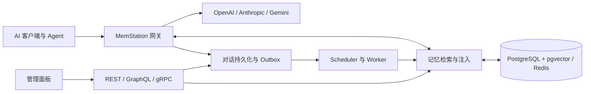

<div align="center">
  <picture>
    <source media="(prefers-color-scheme: dark)" srcset="apps/manager/static/brand/memstation-dark.png" />
    
  </picture>
  <h1>MemStation</h1>
  <p><strong>统一模型入口，让记忆留在自己的基础设施中。</strong></p>
  <p>可自托管的 AI Gateway + Memory System + Admin Plane</p>
  <p>
    <a href="https://github.com/backrunner/memstation/actions/workflows/ci.yml"></a>
    <a href="LICENSE"></a>
    <a href="apps/server/go.mod"></a>
    <a href="apps/manager/package.json"></a>
  </p>
  <p><a href="README.md">English</a> · 简体中文</p>
  <p><a href="#快速开始">快速开始</a> · <a href="docs/architecture.md">架构与能力</a> · <a href="CONTRIBUTING.md">参与贡献</a> · <a href="docs/ci.md">CI 与测试</a></p>
</div>

---

MemStation 为 AI 客户端提供统一网关，以及跨对话保留的长期记忆层。你可以连接不同厂商的模型，为后续请求检索和注入相关上下文，并在一个管理面板中查看对话、修正记忆、统计用量和排查后台任务。

项目优先服务**个人自托管、单实例部署**。v1 的代码基线已落地，生产量级性能验证和运维阈值仍在持续完善；组织、计费与集群部署属于后续路线。


<p align="center"><sub>Manager Dashboard · 使用仓库内的模拟测试数据</sub></p>

## 能做什么

| | 能力 |
| --- | --- |
| **统一接入** | 兼容 OpenAI Chat Completions、OpenAI Responses、Anthropic Messages，支持流式与非流式，上游支持 OpenAI、Anthropic、Gemini。 |
| **保留长期上下文** | 摘要、事实、印象、Key Memory，以及事件、任务、流程、产物、实体和 Agent 行为，保留来源证据与版本历史。 |
| **跨对话检索** | 向量候选、有界图扩展，按语义相关度 × 重要性 × 时间衰减排序，支持可配置的上下文和工具注入。 |
| **查看与修正** | 浏览对话、编辑记忆、管理用户和 Provider 配置、查看 Token 与成本、重试任务、追踪审计。 |
| **自主运维** | 事务 Outbox、可重试 Worker、上游密钥加密、API Key 哈希、OTel/OTLP、健康检查及备份恢复演练。 |

## 架构



Go 服务是唯一业务核心，单二进制提供 `serve`、`worker`、`scheduler`、`migrate`、`seed` 五种角色。SvelteKit Manager 独立部署，通过管理接口访问后端。记忆生命周期、generation 隔离、事实替代链和接口清单见[架构与能力参考](docs/architecture.md)。

## 快速开始

本地准备 Docker / Compose、Node.js 和 **pnpm 12.3.4**。CI 使用 Node.js **24.11.1**、Go **1.26.1**；devcontainer 会提供 Go 工具链。

```bash
git clone https://github.com/backrunner/memstation.git
cd memstation
pnpm install --frozen-lockfile
pnpm dev
```

命令会启动 PostgreSQL 和 Redis、执行迁移，然后在 devcontainer 中运行支持热重载的 Server 和 Manager。未安装 devcontainer CLI 时，脚本会按固定版本自动获取。

1. 打开 **http://127.0.0.1:5173**。
2. 连接 **http://127.0.0.1:8080**，本地开发默认 admin token 为 `memstation-local-admin-token`，也可通过 `MEMSTATION_ADMIN_TOKEN` 覆盖。
3. 在 Settings 中配置 Provider 密钥，以及 chat、summary、analysis 和 embedding 模型。所有模型名通过配置提供。
4. 通过 seed 或管理界面创建用户和 API Key。验证自动记忆生成时，需要同时运行 `worker` 和 `scheduler`；热重载入口启动的是 `serve` 和 Manager。

gRPC 地址为 **127.0.0.1:9090**。包含 Worker 的完整 Compose 启动方式见[开发栈说明](deploy/compose/DEVELOPMENT.md)。其中 reset 命令会删除所选项目的数据库和 Redis 卷，仅用于可丢弃的开发数据。Apple Container 和 Portless HTTPS 调试见[本地调试指南](docs/local-debugging.md)。

## 接入 AI 客户端

把 OpenAI 兼容客户端的 Base URL 设置为 `http://127.0.0.1:8080/v1`，填写 **MemStation API Key**。上游厂商密钥保留在 MemStation，模型名使用实例中已配置的值：

```bash
export MEMSTATION_API_KEY='your-memstation-api-key'
export MEMSTATION_MODEL='your-configured-model'

curl http://127.0.0.1:8080/v1/chat/completions \
  -H "Authorization: Bearer $MEMSTATION_API_KEY" \
  -H 'Content-Type: application/json' \
  -d "{\"model\":\"$MEMSTATION_MODEL\",\"messages\":[{\"role\":\"user\",\"content\":\"Remember that I prefer concise answers.\"}]}"
```

| 接口 | 入口 |
| --- | --- |
| Gateway | `/v1/chat/completions`、`/v1/responses`、`/v1/messages`、`/v1/models` |
| Memory REST | `/api/v1/memory/search`、`/api/v1/memory/keys` |
| 管理 | Admin REST、GraphQL Query/Mutation、服务端 session 鉴权 |
| gRPC | Gateway、Memory、Admin、Health；[protobuf 定义](apps/server/proto/memstation/v1/api.proto) |
| 健康检查 | `/health/live`、`/health/ready` |

## 开发、评测与部署

- **开发：**[本地调试](docs/local-debugging.md)、[工程规范](AGENTS.md)、[贡献指南](CONTRIBUTING.md)。
- **测试：**[CI 门禁与故障说明](docs/ci.md)，Go 单元 / 集成 / 契约测试，Manager Vitest 和 Chromium / WebKit E2E。
- **记忆评测：**[评测与数据集说明](apps/server/tests/eval/README.md)，原生 golden dataset 和外部 LOCOMO / LongMemEval adapter 输出检索明细、分数组成与回归样例。Benchmark 为本地 / 手动入口，不进入默认 CI / nightly 红线。
- **部署：**[Compose](deploy/compose)、[Kubernetes 基线](deploy/k8s)、[Nginx](deploy/nginx)、[OpenTelemetry](deploy/otel)、[备份恢复](deploy/compose/BACKUP_RESTORE.md)。

Compose 默认配置用于本地开发。对外部署前需配置独立密钥、TLS、安全 session cookie 和 CORS 策略，见[安全说明](SECURITY.md)。

## 开源许可证

MemStation 采用 [Apache License 2.0](LICENSE)，欢迎以相同许可证贡献代码。版权和第三方组件说明见 [NOTICE](NOTICE) 与 [THIRD_PARTY_NOTICES.md](THIRD_PARTY_NOTICES.md)。

内置 IBM Plex Sans 字体保留 SIL OFL 许可证。LOCOMO 原始数据采用 **CC BY-NC 4.0**，单独下载，不随本仓库分发，也不转为 Apache-2.0。
