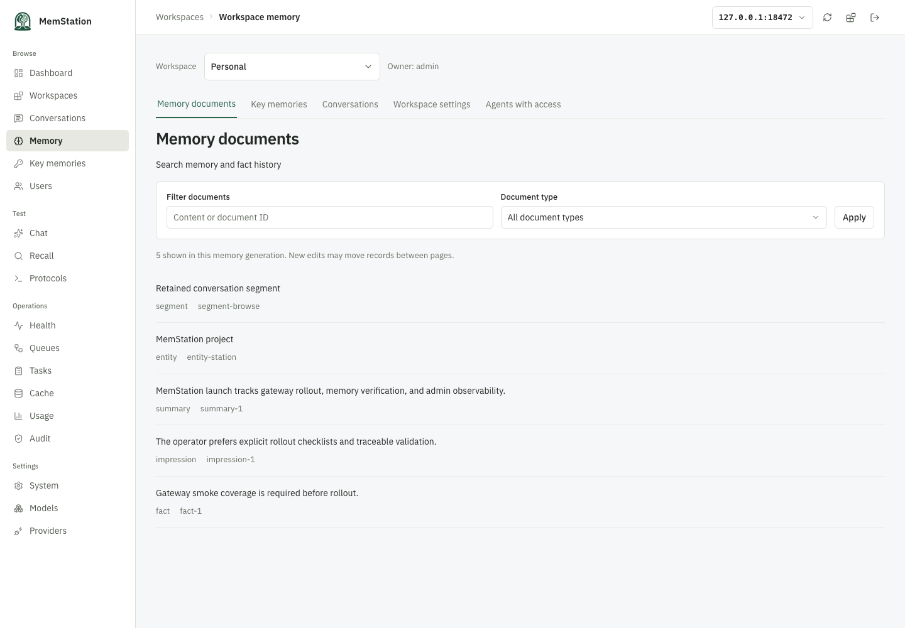
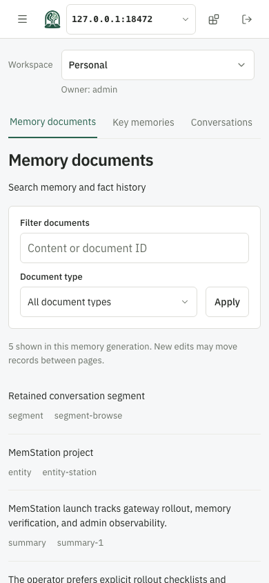
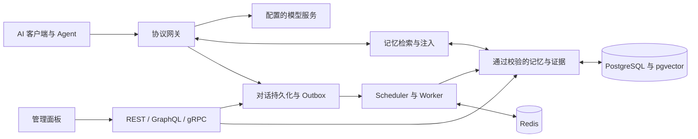

<div align="center">
  <picture>
    <source media="(prefers-color-scheme: dark)" srcset="apps/manager/static/brand/memstation-dark.png" />
    
  </picture>
  <h1>MemStation</h1>
  <p><strong>统一模型入口，让记忆留在自己的基础设施中。</strong></p>
  <p>可自托管的 AI 网关、长期记忆与管理面板。</p>
  <p>
    <a href="LICENSE"></a>
    <a href="https://github.com/backrunner/memstation/actions/workflows/ci.yml"></a>
    <a href="apps/server/go.mod"></a>
    <a href="apps/manager/package.json"></a>
  </p>
  <p><a href="README.md">English</a> &nbsp; 简体中文</p>
  <p><a href="#快速开始">快速开始</a> &nbsp; <a href="#记忆如何工作">记忆链路</a> &nbsp; <a href="#文档导航">文档导航</a> &nbsp; <a href="CONTRIBUTING.md">参与贡献</a></p>
</div>

MemStation 连接 AI 客户端与模型服务，让有用的上下文跨对话保留。你可以查看一段对话如何变成记忆、修正提取结果，并控制后续请求如何检索和使用这些信息。

**当前范围：个人自托管、单实例与 Personal 工作区。** 支持多个 Agent 通过独立凭据共享服务并限制访问范围。群聊摄取、其他工作区类型、组织和计费仍在路线图中，生产量级性能验证也在继续。

<a href="docs/assets/manager-preview.png"></a>
<p align="center"><sub>当前 Manager 界面，使用仓库内的模拟测试数据。</sub></p>

## 为什么使用 MemStation

| 能力 | 具体支持 |
| --- | --- |
| **统一客户端入口** | 兼容 OpenAI Chat Completions、Responses、Anthropic Messages，支持流式与非流式，连接 OpenAI 兼容服务、Anthropic 和 Gemini。 |
| **有来源的长期记忆** | LLM 生成摘要、事实、画像和 Key Memory，以及事件、任务、流程、产物和实体，保留原文引用与事实历史。 |
| **可配置的召回** | 向量候选、有界图扩展，按语义相关度 × 重要性 × 时间衰减排序，通过上下文或记忆工具使用结果。 |
| **可查看、可修正** | 浏览对话、编辑记忆、检查关系、管理 Agent、配置模型、统计用量并重试后台任务。 |
| **部署在自己的环境中** | PostgreSQL 与 pgvector、Redis、上游密钥加密、API Key 哈希、事务 Outbox、可重试 Worker 和 OTel/OTLP。 |

可以使用云端模型、Ollama 等 OpenAI 兼容本地服务，或组合云端文本生成与本地 Embedding。模型名通过配置提供；自动记忆生成前，**必须配置摘要、分析和 Embedding 模型**。模型失败会重试，不使用规则生成语义记忆兜底。

<details>
<summary><strong>查看桌面与移动端的工作区记忆界面</strong></summary>

在选中的工作区内浏览、筛选和修正记录。





截图均为模拟数据，不包含私人对话。[本地重新生成](docs/assets/README.md)。

</details>

## 记忆如何工作



1. 网关归一化协议、检索上下文，并持久化对话和用量。
2. 会话结束写入 Outbox，Scheduler 与 Worker 生成摘要、分析事实和画像、合并 Key Memory，再生成向量。
3. 服务端校验结构、作用域和来源引用。检查点让重试复用已验证结果，版本校验保护人工修改。
4. 后续请求在授权范围内召回记忆，Manager 提供来源、历史和编辑入口。

Go 核心服务以单二进制提供 `serve`、`worker`、`scheduler`、`migrate`、`seed` 五种角色。SvelteKit Manager 独立运行，会话加密保存在服务端。完整能力与边界见[架构说明](docs/architecture.md)、[LLM 生成](docs/llm-memory.md)和[图记忆](docs/graph-memory.md)。

## 快速开始

开发工作流需要 Docker / Compose、Node.js **26.12.1** 和 pnpm **12.15.0**。devcontainer 提供 Go **1.27.3**。

```bash
git clone https://github.com/backrunner/memstation.git
cd memstation
pnpm install --frozen-lockfile
pnpm dev
```

1. 打开 **http://127.0.0.1:5173**，连接 **http://127.0.0.1:8080**。
2. devcontainer 本地默认 admin token 为 `memstation-local-admin-token`，可通过 `MEMSTATION_ADMIN_TOKEN` 覆盖。
3. 配置 Provider 凭据，以及 chat、summary、analysis、embedding 模型；通过 seed 或管理界面创建用户和 MemStation API Key。
4. 测试自动记忆时，需同时启动 `worker` 和 `scheduler`。`pnpm dev` 启动基础设施、迁移、`serve` 与 Manager，不启动 Worker。

**需要包含 Worker 的完整本地栈？** 使用 [Compose 非破坏性启动流程](deploy/compose/DEVELOPMENT.md#start-a-full-local-stack)。Apple Container 与本地 HTTPS 见[本地调试指南](docs/local-debugging.md)。开发默认配置用于本机访问；对外部署前需设置独立密钥、TLS、安全 Cookie 和 CORS，见[安全说明](SECURITY.md)。

## 接入客户端

OpenAI 兼容 Base URL 使用 `http://127.0.0.1:8080/v1`，填入 **MemStation API Key**。上游厂商密钥保留在服务端，模型名使用实例中已配置的值：

```bash
export MEMSTATION_API_KEY='your-memstation-api-key'
export MEMSTATION_MODEL='your-configured-model'

curl http://127.0.0.1:8080/v1/chat/completions \
  -H "Authorization: Bearer $MEMSTATION_API_KEY" \
  -H 'Content-Type: application/json' \
  -d "{\"model\":\"$MEMSTATION_MODEL\",\"messages\":[{\"role\":\"user\",\"content\":\"Remember that I prefer concise answers.\"}]}"
```

| 接口 | 入口 |
| --- | --- |
| Gateway | `/v1/chat/completions`、`/v1/responses`、`/v1/messages`、`/v1/models` |
| Memory REST | `/api/v1/memory/search`、`/api/v1/memory/keys` |
| 管理 | Admin REST、GraphQL Query/Mutation |
| gRPC | Gateway、Memory、Admin、Health；[protobuf 定义](apps/server/proto/memstation/v1/api.proto) |
| 健康检查 | `/health/live`、`/health/ready` |

## 文档导航

| 目的 | 文档 |
| --- | --- |
| 开发与贡献 | [本地工作流](docs/local-debugging.md)、[贡献指南](CONTRIBUTING.md)、[工程规范](AGENTS.md) |
| 配置 Manager | [服务连接、会话与网络策略](docs/manager-connections.md) |
| 理解记忆机制 | [架构](docs/architecture.md)、[LLM 生成](docs/llm-memory.md)、[图关系与事实历史](docs/graph-memory.md) |
| 工作区与多 Agent | [实现状态与接入规划](docs/plans/workspace-agents/README.md)，目前仅开放 Personal |
| 验证功能 | [CI 与测试](docs/ci.md)、[检索评测](apps/server/tests/eval/README.md) |
| 部署与运维 | [Compose](deploy/compose/DEVELOPMENT.md)、[Kubernetes 基线](deploy/k8s)、[Nginx](deploy/nginx)、[Telemetry](deploy/otel)、[备份恢复](deploy/compose/BACKUP_RESTORE.md) |
| 开源范围 | [公开前检查与许可边界](docs/open-source.md)、[第三方声明](THIRD_PARTY_NOTICES.md) |

检索 Benchmark 作为本地、手动诊断，不进入默认 CI / nightly 红线。仓库分发原生 golden dataset，LOCOMO 和 LongMemEval 等外部数据单独下载。确定性测试向量只验证评测链路，不代表真实模型召回质量。

真实模型的召回、来源回放和负载结果见 [2026-10-25 效果评测](docs/memory-quality-2026-10-25.md)，其中明确记录尚未达标的部分。

## 参与贡献

欢迎[报告问题](https://github.com/backrunner/memstation/issues/new/choose)、提出改进或提交范围清晰的 PR，附上复现步骤和模拟数据，详见[贡献指南](CONTRIBUTING.md)。安全漏洞请[私下报告](https://github.com/backrunner/memstation/security/advisories/new)。

## 开源许可证

采用 [Apache License 2.0](LICENSE)，版权及第三方说明见 [NOTICE](NOTICE) 与 [THIRD_PARTY_NOTICES.md](THIRD_PARTY_NOTICES.md)。允许按许可条款商业使用、修改与再分发，包含明确的专利授权，参见[官方许可原文](https://www.apache.org/licenses/LICENSE-2.0)。

内置字体保留 SIL OFL 1.1，依赖保留各自许可证。模型权重和云端模型服务不随项目提供。LOCOMO 外部数据采用 CC BY-NC 4.0，不随仓库分发，也不转为 Apache-2.0。
