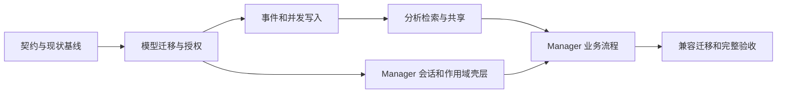

# 工作区与多 Agent 实施和验收

状态：待实施。所有阶段的功能完成状态均为未完成。文档与原型验证见 [validation.md](validation.md)，不能替代下述门禁。

## 1. 执行顺序



图中表示依赖关系，不要求多 Agent 并行开发。每阶段都要具备可审查的迁移、DTO、测试和 UI 状态，禁止通过先上线 UI、后补权限的方式拆分交付。

| 阶段 | 交付与工作包 | 完成门禁 |
| --- | --- | --- |
| P0 | 固定领域词汇、capability 表、接口 schema、旧键和旧会话兼容规则；记录当前未提交修改与测试基线 | 契约覆盖三种协议、REST、GraphQL、gRPC；fixture 和 schema 无歧义 |
| P1 | Workspace／Actor／Agent／Grant／Subject；扩展现有表、默认空间迁移、AccessContext；完整读写范围 | PostgreSQL 空库／旧库迁移；跨 owner/workspace/partition 查询和写入拒绝；旧个人路径通过 |
| P2 | SourceEvent、Run、Integration、批量摄取、幂等、窗口封存、源编辑撤回；Gateway 两种上下文模式 | 多 Agent 并发、重复来源、乱序、崩溃恢复及源事务回滚通过 |
| P3 | 主体归属、候选与 CAS、全链路检索过滤、发布与撤回、分空间 generation／缓存／blob | 事实不串主体，工具和图不绕权，重建与撤回竞态通过；手动质量 artifact 导出 |
| P4 | Manager 服务端会话、Target 登记、路由、ScopeContext、Workspace picker、旧路由迁移 | server load 无凭据泄漏；快速切换／多标签／401／旧服务兼容；桌面与移动壳层通过 |
| P5 | Workspace／Agent／Integration／成员／记忆／Run／共享／运维完整页面；接入样例 | Vitest、fixture Playwright、真实服务关键 E2E；全部失败与空态、权限和编辑冲突流程 |
| P6 | 非破坏迁移演练、回退、备份恢复、Worker 恢复、多 Agent 压测、文档与发行检查 | 完整质量矩阵通过，真实服务证据和容量报告齐全，阻塞项清零 |

不在计划中虚构工期。P0 记录现有基线的真实失败、开发环境容量和实际迁移数据量后再估算。所有 P0–P6 都在本次完整交付范围。

## 2. 代码影响范围

| 层 | 主要路径与工作 |
| --- | --- |
| Domain／ports | `apps/server/internal/domain/`、`internal/ports/interfaces.go`：typed 身份、作用域、事件和 revision 契约 |
| Schema／迁移 | `apps/server/ent/schema/`、`ent/migrate/migrations/`：新增实体、所有派生表归属、索引、FK、backfill；同步 Ent generated |
| Security | `internal/security/`、`internal/service/apikey/`：完整 principal、期限／撤销／grant、缓存版本、错误语义 |
| Services | 新增 workspace/agent/identity/ingestion；改造 conversation/gateway/analysis/memory/memorygen；handler 保持薄层 |
| Stores | `internal/store/sql/`、`internal/store/vector/`：复合归属、前置过滤、分空间 generation、CAS、追加事件 |
| Workers | `internal/worker/`、outbox/scheduler：窗口版本、权限分区、源撤回、去重、失败恢复 |
| HTTP／gRPC／GraphQL | `internal/transport/`、`proto/memstation/v1/`、`graph/`：同一 AccessContext 和返回 DTO；同步生成代码 |
| Manager | `apps/manager/src/lib/`、`src/routes/`、`e2e/`：按 manager.md 重组，复用现有组件与视觉 token |
| 运维／评测 | `scripts/ops/`、`scripts/test/`、`apps/server/tests/eval/`：扩充作用域和并发用例、恢复清点、质量诊断 |
| 文档 | AGENTS、README 中英文、架构、部署、接入、迁移与 API 示例保持状态一致 |

现有工作区含未提交图记忆／Manager 改动，实施前必须建立准确基线并保留。不能通过 reset、全文件覆盖或重跑生成器后盲目接受 diff 丢掉既有修改。

## 3. 迁移和发布方案

### 3.1 非破坏扩展

1. 备份并记录按 user、conversation、memory type、generation、blob 的计数和可验证 hash；在隔离实例先恢复验证。
2. Atlas 新增版本化迁移，先建立 Workspace／Actor／Agent／Subject／Grant 等表，以及现有表的可空新列和索引。不得修改已发布迁移。
3. 为每个 User 创建确定性默认个人 Workspace、默认 human Actor 和 legacy Agent；旧 API Key 关联 legacy Agent 和默认空间，保持原有合法使用能力但不自动获得跨空间权限。
4. 从既有父记录关系回填所有 messages、memory entities、nodes、relations、vectors、keywords、evidence、history、snapshots、outbox、usage、blob 和 generations。无法确定的对象隔离并输出审查清单，不按字符串猜测群或人物。
5. 旧 `subject=user` 只映射到该 User 的默认 Actor；现有实体和别名保留 ID／映射，不凭空确认现实人物。旧生成 Agent 未知时标记 legacy，不能伪造来源。
6. 在全量回填校验完成后增加 NOT NULL／复合 FK／新唯一性和 active generation 每空间约束；关闭 user-only 无范围读取。

历史 UserSetting 中的 embedding 字段仅用于兼容检查，不在新空间或 Agent 继承为可自由切换配置。与部署级模型／维度不一致的向量列入重嵌入清单，完成兼容索引后再激活；迁移不得混合不可比较的向量。

### 3.2 切换和任务排空

首版采用明确的维护窗口，避免承诺混合新旧 Worker 的在线迁移：暂停新写入 → 排空或持久记录旧任务 → 停止旧 scheduler/worker → 应用迁移与回填 → 新版本读取校验 → 新 worker 处理已映射旧任务 → 开放新写入。

源事件和任务 payload 带 schema version。旧无 workspace payload 只能通过已经完成的 legacy 映射解析；未知映射进入隔离失败队列，禁止退回 admin／任意用户。迁移可断点续跑，chunk 游标和 checksum 记录在 migration job，重复执行不重复创建数据。

首次只启用默认个人空间，完成旧客户端回归后再开放创建其他空间。能力开关不能允许新 UI 对未支持的新数据写入。

### 3.3 回退

- 新空间写入之前，可以停止服务并恢复迁移前备份／旧版本；先核对恢复计数。
- 新空间写入之后，旧二进制不理解隔离语义，不能直接降级运行。优先前向修复；需要回退时停写，导出新增源事件与审计，恢复备份，并明确待重放范围。
- 禁止把新 Workspace 数据压平回 user-only 模型；不能以“恢复成功”掩盖丢失的新事件。
- 回退 generation 与回退数据库分开。generation 回退须保持源撤回和最新 revision 约束，避免复活旧事实。

## 4. 正确性验收矩阵

这些是确定性的权限和业务契约测试，不是 retrieval benchmark 指标门禁。

| 编号 | 用例 | 必须结果 |
| --- | --- | --- |
| A01 | 同 owner 两个群，使用同一个 Agent，询问相同主题 | 只返回当前群可见记忆，含图扩展和 fallback |
| A02 | 同 Workspace 两个 Agent，有共享记忆和私有笔记 | 共享内容互通，私有内容不出现在对方检索／计数／证据／工具中 |
| A03 | 同名人物、同人跨群、跨平台相同外部 ID | 身份按 namespace 消歧，确认身份不自动扩大记忆权限 |
| A04 | 甲和乙相反偏好，甲转述乙，机器人复述旧记忆 | 主体归属正确，转述保留 speaker，复述不增加独立证据 |
| A05 | 修改 headers／body／工具参数中的 owner、workspace、run、subject，冒用 Integration sender | 全 transport 拒绝越权，不能改写已有 Conversation 归属或冒用未授权来源身份 |
| A06 | 私有源与共享源混合生成摘要／关键词／向量 | 分区保持可见边界，不通过派生数据泄漏 |
| A07 | 两个 Agent 同时上报同一外部事件；同 key 异 payload | 同源只落一次／计证据一次，冲突返回稳定错误 |
| A08 | 两个 Agent 同时追加同一协作会话 | 两组事件均保存，sequence 唯一，没有历史覆盖 |
| A09 | 并发修改同一 fact/key/grant | 一方 CAS 成功，另一方冲突；候选和审计完整 |
| A10 | 事件事务中断、DB 提交后 relay 崩溃、重复消费 | 全事务回滚或可恢复；无丢事件、重复业务效果 |
| A11 | 显式封窗、阈值、超时同时发生；持续活跃群 | 同版本仅一次处理；有界窗口最终进入分析 |
| A12 | 迟到消息、旧编辑、源撤回与 embedding 完成竞争 | 不倒退消息、不复活撤回内容、失效派生不可注入 |
| A13 | Agent 撤权后命中缓存／旧 context／工具链续调 | 新访问失败，不能等待 TTL 后才生效 |
| A14 | 共享发布、源修订、发布撤回、源删除 | 目标只看发布内容；撤回立即停止使用并清理派生 |
| A15 | 项目不同分支中同一个事实键 | 保留适用条件，不错误 supersede |
| A16 | 一个空间重建时另一个空间持续写入 | generation、watermark、缓存隔离；激活后增量不丢失 |
| A17 | 归档／删除空间、解绑 Actor、停用 Agent | 生命周期行为与审计一致，不能残留可读向量或 blob |
| A18 | Gateway 重试、SSE 中断、同 request 并发 | 不自动重复上游生成；状态和 usage 反映实际确认结果 |
| A19 | client_history 和 events 会话混用 | 明确拒绝；event 模式不重复记录投影消息 |
| A20 | 旧个人 key 和三种协议，流式／非流式及工具 | 原有合法行为继续可用，无新字段也能工作 |
| A21 | HTTP／gRPC／GraphQL／原始文件／历史／导出 | 相同作用域与错误语义，直接 ID 访问无旁路 |
| A22 | 备份恢复后源、grant、private memory、publications、generation | 计数、权限、事实版本和引用一致，可继续处理任务 |

## 5. Manager 验收矩阵

| 编号 | 流程 | 桌面与移动共同结果 |
| --- | --- | --- |
| U01 | 首次连接 → 建空间 → 建 Agent → 获取 key → 查看接入说明 | 步骤清楚，key 只显示一次，无 storage／URL／日志泄漏 |
| U02 | 快速切换同名空间、不同 Target、后退／前进、多标签 | 不闪现或覆盖成其他作用域数据；深链接稳定 |
| U03 | 搜索、组合筛选、展开详情、返回列表 | 条件和位置保留；当前空间明确 |
| U04 | 从成员画像 → Fact → 原始消息 → Run／工具结果 | 链接可达、权限一致、直接证据与推断可辨 |
| U05 | 另一管理员保存后再保存本地草稿 | 409 不丢草稿，可比较合并，不无提示覆盖 |
| U06 | 编辑 Agent grant、撤销 key、刷新、旧 context 再请求 | 有效权限和结果及时更新，旧权限不残留 |
| U07 | 发布／撤回共享记忆、来源撤回 | 显示明确目标和影响，不附赠源会话权限 |
| U08 | 分析失败、Target 失联、401/403/404/429、索引落后 | 显示对应原因和恢复操作，不虚报处理完成 |
| U09 | 空态、长名、长文本、窄屏、短屏、200% 缩放 | 主要信息和操作可见，无页面横向溢出 |
| U10 | 键盘遍历、Dialog 打开关闭、触屏和软键盘 | 焦点正确、标签完整、44px 操作、16px 输入 |
| U11 | 运维页面定位 Worker Task 与外部 Run | 二者不混淆，不显示无法执行的远程停止操作 |
| U12 | 旧服务能力不足／旧书签跳转 | 保留个人模式，明确需要升级，不虚构写入成功 |

Fixture E2E 验证页面行为；至少 A01/A02/A09/A13/A20 与 U01/U04/U06 另用真实 PostgreSQL、Redis、Go 服务和 Manager 跑端到端测试。确定性 stub provider 用于契约；真实模型画像质量单独评测。

## 6. 质量、性能与可靠性

记忆质量沿用 Go eval runner 和线上 MemoryEngine。扩展 repo-native 数据，包含两群同名成员、跨群不同偏好、多 Agent 共享／私有、引用与转述、代码分支和撤回证据。输出 wrong-workspace、wrong-subject、重复证据、stale-fact、Recall／nDCG 与 relation gain 诊断；LOCOMO／LongMemEval 继续按原许可和手动执行策略处理，不进入默认 CI 红线。

性能验收在明确机器、DB、向量维度、数据规模和并发参数的独立环境执行：至少同时运行 20 个 Agent、10 个 Workspace，包含热空间与冷空间，记录摄取吞吐、请求错误、锁等待、各空间检索 P95、流式首包附加开销和恢复耗时。20/10 是首轮测试配置，不是产品容量承诺；进一步增加到瓶颈并记录容量曲线。

保持 AGENTS SLO：非流式附加 P95 <150ms、流式首包附加 P95 <250ms、检索 P95 <250ms、Summary P95 <60s、分析 P95 <120s、积压 15 分钟内恢复正常。摄取和鉴权额外开销独立测量并在容量报告中制定可验证预算，不用无数据的性能数字宣称完成。

Worker 与 Redis／PostgreSQL 恢复演练加入多空间和权限分区，确认重放不重复计数、撤回不复活。artifact upload 使用短保留和 best-effort，正确性门禁不能因此降级。

## 7. 实施期间检查入口

沿用仓库固定版本和统一脚本。新增依赖才核对写入时最新稳定版本并记录兼容性，不在规划阶段无故升级整个工具链。

```sh
rtk proxy bash ./scripts/go/format.sh --check
rtk proxy bash ./scripts/go/lint.sh
rtk proxy go -C apps/server test ./...
rtk proxy go -C apps/server generate ./...
rtk git diff --exit-code
rtk pnpm lint
rtk pnpm test
rtk pnpm --filter @memstation/manager build
rtk pnpm test:contract
rtk pnpm test:e2e:manager
rtk proxy bash ./scripts/ops/check-atlas-migrations.sh
rtk pnpm test:backup:dry-run
```

生成差异门禁在已提交预期 schema/generated 变更的干净基线执行；不能在本次已有脏工作区把全部 diff 当作生成回归。PostgreSQL／Redis 集成测试和真实服务 E2E 使用隔离数据库、端口和 namespace，不运行会删除用户数据的 dev reset 命令。受影响并发包增加 `go test -race`，备份恢复和 Worker recovery 另按 scripts/ops 实际入口在专用环境执行。

默认不使用 `pnpm test:all` 代替上表，因为当前组合脚本包含显式 eval；CI／nightly 不因此加入 benchmark 判定。

## 8. 风险与处理

| 风险 | 处理与发布阻塞条件 |
| --- | --- |
| 只加 workspace 字段，遗留旁路仍按 user 查 | 全表／全 repository／全 transport 清单核对；A01/A02/A21 未通过阻塞发布 |
| 摘要／证据／向量缓存放大可见范围 | 分区传播和源版本校验；缺少确定范围时拒绝读取／写入 |
| 旧 Conversation ID 可改变所属 user | 服务端映射和不可变归属；并发 upsert 契约必须修复 |
| 旧 generation 回收影响其他空间 | 以空间为单位的数据范围、dry-run 清单与真实回收测试 |
| Manager 薄代理引入任意目标访问或会话串用 | 服务器目标登记、允许地址、同源会话、target 绑定及自动回归 |
| 老客户端不能传新 header | 凭据默认空间与兼容模式，不要求所有客户端立即升级 |
| 模型误认人物或把转述当事实 | 来源结构化、候选验证、保守 fallback、人工修正；质量观察与权限测试分开 |
| UI 范围切换晚到响应污染 | ScopeContext＋请求取消＋revision guard，U02 必须覆盖 |

## 9. 发布完成清单

- [ ] P0–P6 的实现、生成代码和迁移完成。
- [ ] A01–A22、U01–U12 有对应自动化／明确人工证据。
- [ ] 旧客户端兼容、数据库升级与恢复、单空间重建通过。
- [ ] 所有协议与工具共享授权与来源规则。
- [ ] 管理面板移动与桌面关键操作由真实服务验证。
- [ ] 容量、SLO、积压恢复报告具备环境与原始 artifact。
- [ ] 模型质量评测输出失败样例和可追踪来源，未把确定性 fixture 当真实模型能力。
- [ ] 中英文 README、AGENTS、接入、部署、配置和升级文档同步最终行为。
- [ ] 发布、提交、推送与部署在用户后续明确要求的范围内执行；本次计划交付不触发发布。
